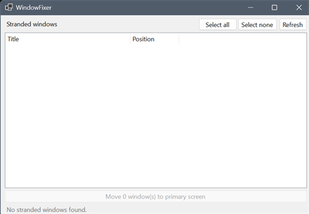

# RdpWindowPosFixr

A small Windows desktop utility that rescues **stranded windows** — application windows whose position falls outside the visible desktop after an RDP session shrinks a multi-monitor setup down to a single screen.

After such a reconnect, apps that were on the second monitor can still appear on the taskbar but are impossible to see or reach. This tool finds them and moves them back onto the primary screen.

## Usage

1. You connect with RDP and notice that some windows are missing, and they can't be maximised/restored/moved to the RDP screen.
2. Launch the app (accept the UAC prompt). It scans immediately.
3. Review the list of stranded windows; use **Refresh** after closing or opening apps.
4. Tick the windows to rescue (**Select all** / **Select none** are shortcuts).
5. Click **Move N window(s) to primary screen**.
6. The list re-scans; anything that could not be moved is shown in the status line.



## Requirements

- Windows
- .NET 10 SDK (for building) or the .NET 10 Windows Desktop runtime (to run a published build)

## Build and run

```powershell
dotnet build src/WindowFixer.csproj
dotnet run --project src/WindowFixer.csproj
```

`dotnet run` triggers the elevation prompt defined in `src/app.manifest`.

Publish a single-file executable:

```powershell
dotnet publish src/WindowFixer.csproj -c Release -r win-x64 --self-contained false -p:PublishSingleFile=true
```

## How it works

The project is a single .NET 10 WinForms app with no third-party dependencies:

| File | Responsibility |
| --- | --- |
| `src/Program.cs` | Entry point. |
| `src/MainForm.cs` / `src/MainForm.Designer.cs` | UI: list of stranded windows, selection, refresh, move action. |
| `src/WindowScanner.cs` | Enumerates windows, computes virtual screen bounds, detects stranded windows. |
| `src/WindowRescuer.cs` | Moves normal, minimized, and maximized windows to the primary screen. |
| `src/NativeMethods.cs` | P/Invoke into `user32.dll` and `dwmapi.dll`. |
| `src/WindowInfo.cs` | Model for a stranded window (handle, title, restore rect, state). |

Detection and placement use physical pixels. `WINDOWPLACEMENT.rcNormalPosition` is in workspace coordinates, so the scanner calibrates the offset against a window in the normal state before comparing positions. For maximized windows, the invisible DWM resize border makes the window rectangle slightly larger than the screen, so the rectangle center is tested instead of full containment.

## Limitations

- Windows only.
- Intended for the RDP reconnect scenario; it does not manage monitor topology or save/restore layouts.
- An app that snaps itself back to its saved position right after being moved will simply reappear as stranded on the next scan.

## Disclaimer

Developed with AI assistance and human oversight.   
Tools used: OpenCode (+Oh My OpenCode Slim), OpenSpec, Visual Studio 2026.

